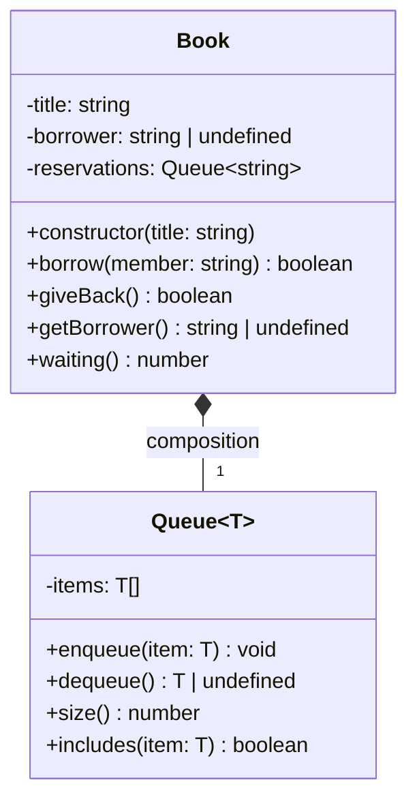

## Part 1: The `any` version

- **Red underline?** No. `any` turns off type checking, so TypeScript doesn't complain.
- **Running it:** `awa.getName()` prints `Awa`. Then `awa.describe()` crashes with `TypeError: awa.describe is not a function`, because `Member` has no `describe()`.

### Q1

- Using `any` gives up safety checks, autocompletion, and early error detection. Mistakes become crashes at runtime.
- `memberList.add(42)` is **not** caught at compile time. At runtime it crashes: `item.getId is not a function`.

## Part 2: A generic catalog

### Q2

- Error: `Property 'getId' does not exist on type 'T'.`
- `T` could be anything (number, string...). TypeScript can't be sure it has `getId()`, so it refuses.

### Q3

- TypeScript checks the *shape*, not the name. `Book` and `Member` both have `getId()`, so they fit `HasId` without writing `implements`.

### Q4

- (a) `books.add(new Member(...))` fails because the catalog only accepts `Book`.
- (b) `new Catalog<number>()` fails because `number` has no `getId()`. The `extends HasId` rule blocks it.
- (c) `found.describe()` fails with `'found' is possibly 'undefined'`. `find` can return `undefined`, so you must check first.

### Prediction 2

- No test line needs to change. The output stays the same:

  ```text
  true
  true
  false
  2 1
  So Long a Letter [B-002]
  Awa
  undefined
  ```

### Q5

- Nothing changed for the caller because of **encapsulation**. The inside changed (Array → Map), but the public methods stayed the same.

### Q6

- Breaking line: `books.all().push(new Book("B-001", "Duplicate Book"));`
- Returning a **copy** means pushing only changes the copy. The real catalog stays safe.

## Part 3: Generic or not?

### Q7

- Error: `Property 'describe' does not exist on type 'Borrowable'.`
- `Borrowable` only promises `lateFee()`. Some items (like `Laptop`) have no `describe()`, so TypeScript can't allow it.

### Prediction 3

- `worstOverall` has type `Book | Laptop | undefined`.
- `worstOverall.describe()` is **rejected**, because `Laptop` has no `describe()`.

### Q8

- Rule: a generic is worth it when the function **returns something whose type depends on the input type**.
- `totalFees` returns just a number, so no generic is needed. `mostCostly` returns one of the items, so the generic keeps the exact type (`Book | Dvd`, `Book | Laptop`).

## Part 4: A generic class as a part

### Q9

- `T` is chosen here: `private reservations: Queue<string> = new Queue<string>();`. So `T` = `string`.
- If `Book extends Queue<string>`, anyone could call `book.enqueue("Moussa")` and skip the rules.

### Q10

- First `borrow("Moussa")`: the book was taken, so Moussa joined the waiting queue.
- Second `borrow("Moussa")`: he was already in the queue, so nothing changed.
- A `boolean` can't tell the caller *which* case happened or *why* it returned `false`.

### Task 3: Mermaid diagram



### Q11

- I chose **composition**. A `Book` *has a* `Queue`, it is not a `Queue`. The queue is a private part of the book. Only `Book` controls it, so outside code can't break the rules.

## Part 5: What generics cannot do

### Prediction 4

- Red underline: `'T' only refers to a type, but is being used as a value here.`
- Running it anyway **stops** with `ReferenceError: T is not defined`, because `T` doesn't exist at runtime.

### Prediction 5

- The two lines print:

  ```text
  Things Fall Apart
  NaN
  ```

- The JSON has no `copies`, so `books[0].copies` is `undefined`, and `undefined + 1` is `NaN`.

### Q12

- Both results come from **type erasure**: types disappear when the code runs.
  1. `instanceof T` fails because `T` doesn't exist at runtime.
  2. `parseJson<BookData[]>` checks nothing. `JSON.parse` just returns whatever is in the string.
- Data from outside (APIs, files, user input) must be checked **at runtime**, for example with Zod or your own check functions.

## Part 6: Homework — The `Ratings<T extends HasId>` class

### Q13

- If `best()` returned `HasId` instead of `T`, the caller could only call `getId()`. They could no longer call methods specific to the item, like `top.describe()` on a `Book` or `top.getName()` on a `Member`. Returning `T` preserves the exact type.

